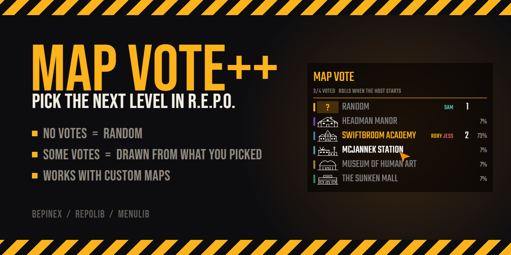
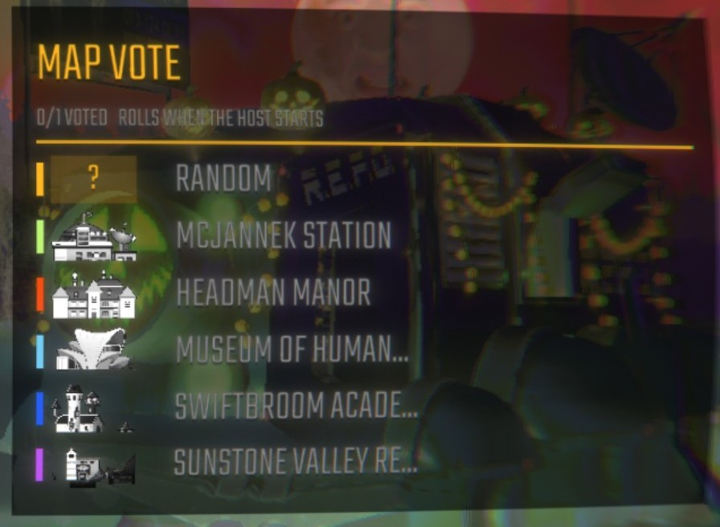
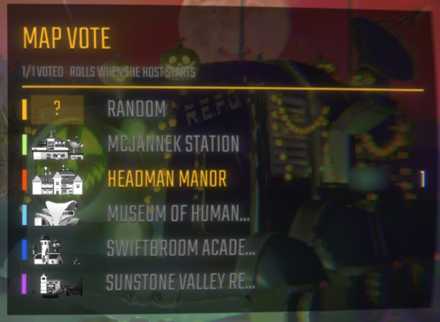
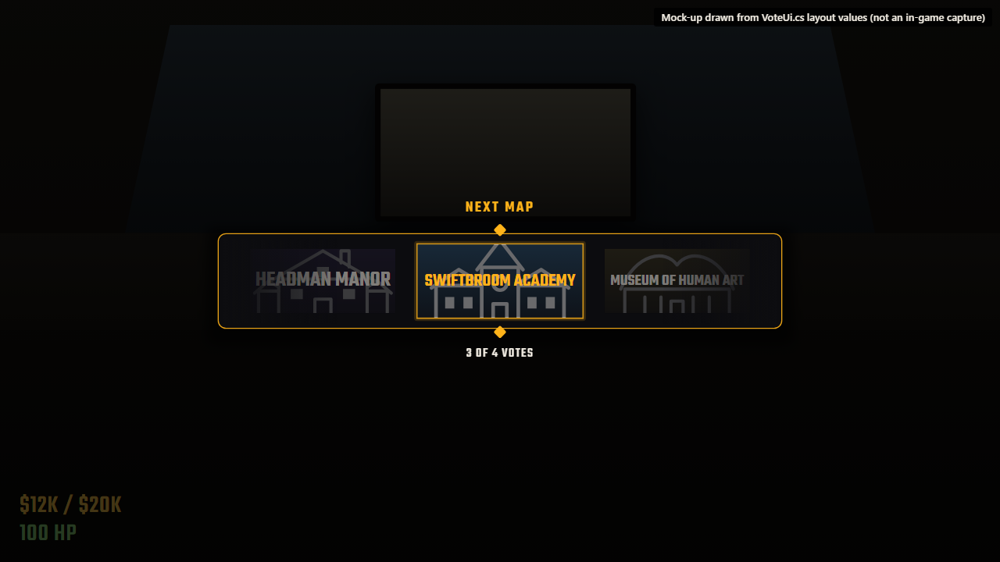
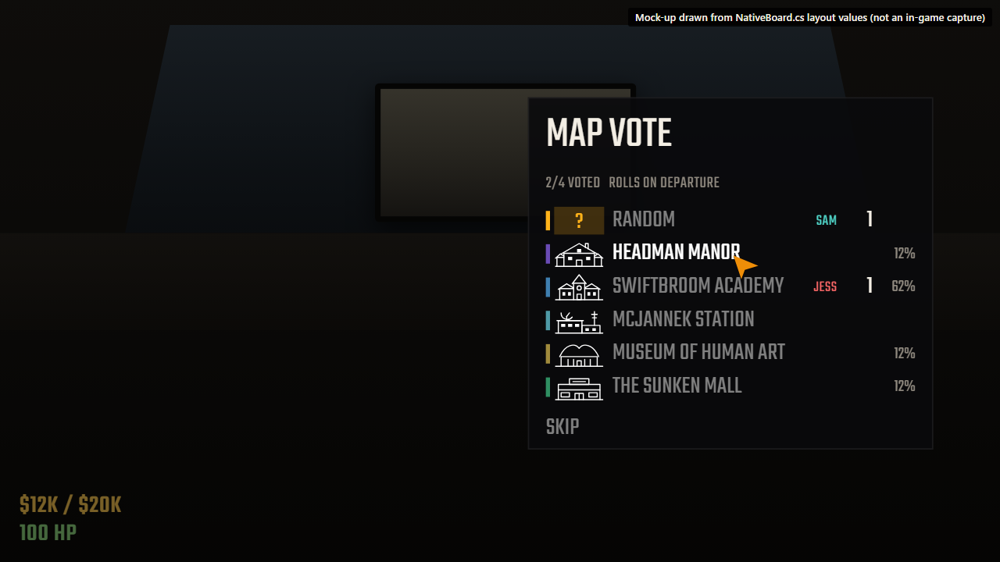

<p align="center">
  
</p>

<p align="center">
  <a href="https://github.com/RoryDotGG/REPO-MapVotePlusPlus/blob/main/LICENSE"></a>
  
  
  
</p>

**MapVote++** lets your crew vote on the next level, in the truck between levels or in the pre-game lobby. It reads the map list from the game at runtime, so new official maps and custom maps show up without any config.

## How the next map is picked

- If nobody votes, you get a random map that isn't the one you just played, as in vanilla.
- If anyone votes, the winner comes only from the maps people picked. How depends on the host's `VoteMode`:
  - **Lottery** (the default): each vote is one ticket, so 3 votes for A and 1 for B gives A a 75% chance and B 25%.
  - **Majority**: the map with the most votes wins. A tie is drawn at random between the tied maps, so 2 votes each for A and B is 50/50, and a map with fewer votes can't win.
- A vote for Random can land on any map on the list. In a lottery it's one ticket. In a majority vote it counts as a choice of its own: if Random has the most votes, or ties and is drawn, the next map is random.
- The list shows who has voted for each map as the votes come in.
- The host can limit how many maps each vote offers with `MapsPerVote`. Each time a vote opens, that many maps are drawn at random, never including the one you just played. Random, and the pick when nobody votes, only land on one of those maps. The vote list says so, for example **3 OF 5 MAPS, DRAWN AT RANDOM**.

## What it looks like

The vote list is part of the game's own menu, built with MenuLib, so it uses R.E.P.O.'s font, buttons and cursor. In the lobby it sits to the right of the player list.

| Before anyone votes | After a vote |
| --- | --- |
|  |  |

When the host presses **Start Game**, or someone sends the truck off, the game dims and a reel in the middle of the screen lands on the next map for everyone:



In the truck, the same list pops up when you arrive, so you can pick a map or skip it. **M** opens it again:



<sub>The reveal and truck shots are mock-ups drawn from the UI's layout values. The lobby shots are in-game captures.</sub>

## How to vote

| Where | What you see | Controls |
| --- | --- | --- |
| Truck | The vote menu opens when you arrive. After that, a **MAP VOTE** box bottom-right | Click a map, or press `1`-`9` (`R` for Random), and the menu closes. **Skip**, `M` or `Esc` closes it without voting. **M** opens it again. |
| Lobby menu | A **MAP VOTE** panel to the right of the player list | Click a map, or press `1`-`9` (`R` for Random). |

- Click your pick again to clear your vote.
- Neither vote has a timer. Anyone can vote or change their vote until the vote rolls, including players who join the lobby late.
- In the lobby, the vote rolls when the host presses **Start Game**. The reveal plays, and the game starts once it lands.
- In the truck, the vote rolls when someone sends the truck off. The reveal plays, landing on a random map if nobody voted, and the truck leaves once it lands.
- The truck's **MAP VOTE** box pulses until you vote. If you skip, it stops pulsing, and you can still vote with **M** until the truck leaves. Turn off `ShowVoteOnArrival` to open the truck vote yourself instead.
- The reveal is a slot-machine reel in the middle of the screen, with the game dimmed behind it. It lands on the next map for everyone at once, and the vote list doesn't show the winner until it does.

## Install

With a mod manager (r2modman, Gale), search for **MapVotePlusPlus** in the Online tab and install it. REPOLib and MenuLib are installed with it.

To install by hand, set up BepInEx, [REPOLib](https://thunderstore.io/c/repo/p/Zehs/REPOLib/) and [MenuLib](https://thunderstore.io/c/repo/p/REPOModding/MenuLib/), then put `MapVotePlusPlus.dll` in `BepInEx/plugins/MapVotePlusPlus/`.

Everyone in the lobby needs the mod. The host runs the vote.

If you can't vote because of the host, the vote list greys out its maps and says why:

| It says | Why | Next map |
| --- | --- | --- |
| **HOST DOESN'T HAVE MAPVOTE++** | The host isn't running the mod. | Random |
| **HOST HAS TURNED THIS VOTE OFF** | The host switched off `VoteInLobbyMenu` or `VoteInTruck`. | Random |
| **HOST HAS V…, YOU HAVE V…** | Your versions can't talk to each other. | The host's vote, without you |
| **NO REPLY FROM THE HOST'S VOTE** | The host has the mod, but its vote never reached you, usually because your mod lists differ. See [Compatibility](#compatibility). | The host's vote, without you |

## Config

`BepInEx/config/RoryDotGG.MapVotePlusPlus.cfg`

| Key | Default | Notes |
| --- | --- | --- |
| `Controls.ToggleKey` | `M` | Opens the vote in the truck. Any Unity Input System key name. |
| `Voting.VoteInLobbyMenu` | `true` | |
| `Voting.VoteInTruck` | `true` | |
| `Voting.ShowVoteOnArrival` | `true` | Opens the truck vote when you arrive, so you pick a map or skip first. Each player's own setting. |
| `Voting.MapsPerVote` | `All` | `All`, or 2 to 20. How many maps each vote offers, drawn at random every vote and never the map you just played. The host's value is used. |
| `Voting.VoteMode` | `Lottery` | `Lottery`: each vote is a ticket in a draw. `Majority`: the most votes wins, and a tie is drawn at random. The host's value is used. |

### Changing settings in game

With [REPOConfig](https://thunderstore.io/c/repo/p/nickklmao/REPOConfig/) installed, press **Mods** in the main menu, the lobby or the escape menu, pick **Map Vote++**, change a setting and press **Save Changes**. Changes apply straight away:

- **Maps Per Vote** draws the open vote's list again. Votes for Random, or for a map that's still on the list, are kept.
- **Vote Mode** applies to the open vote straight away, and everyone's odds change with it. Once the reveal has started, the map it lands on stands and the change applies to the next vote.
- If the host switches off **Vote In Lobby Menu** or **Vote In Truck** where a vote is open, it closes and the next map is random. Switching it back on opens a new vote.
- **Toggle Key** works at once. Switching on **Show Vote On Arrival** applies the next time you arrive in the truck.

## How it works

Clients send their votes to the host over REPOLib `NetworkedEvent`s. The host draws the winner and broadcasts the full vote state, so players who join mid-vote catch up immediately. The state carries the host's vote rules too, so every player's odds and reveal follow the host's settings. To load the winner, the host patches `RunManager.SetRunLevel`, and the game's own level sync tells every client which map it is.

The host also puts its MapVote++ version and vote settings in the Photon room's custom properties. Every player gets these on joining, whatever mods they run. That's how a player tells a host without the mod apart from a vote that hasn't reached them yet.

Maps come from `REPOLib.Modules.Levels.AllLevels`. Each `Level` asset supplies the map's name, thumbnail (loading-screen art) and accent colour (fog colour), so custom maps get them too.

The vote list is made of the game's own menu buttons, via MenuLib. It's docked on the lobby page and opens as a popup page in the truck, where the game frees the cursor and holds the player while it's open. The reveal reel and HUD box are drawn in code on an overlay canvas, with procedural sprites and no asset bundle.

| File | Purpose |
| --- | --- |
| [`src/VoteLogic.cs`](https://github.com/RoryDotGG/REPO-MapVotePlusPlus/blob/main/src/VoteLogic.cs) | Pure vote rules (no Unity), covered by `tests/VoteLogicCheck` |
| [`src/VoteSession.cs`](https://github.com/RoryDotGG/REPO-MapVotePlusPlus/blob/main/src/VoteSession.cs) | State, networking, host timers, level override |
| [`src/HostCheck.cs`](https://github.com/RoryDotGG/REPO-MapVotePlusPlus/blob/main/src/HostCheck.cs) | Whether the host can run a vote with you, and if not, why |
| [`src/NativeBoard.cs`](https://github.com/RoryDotGG/REPO-MapVotePlusPlus/blob/main/src/NativeBoard.cs) | The vote list, as a game menu (MenuLib) |
| [`src/VoteUi.cs`](https://github.com/RoryDotGG/REPO-MapVotePlusPlus/blob/main/src/VoteUi.cs) | HUD box, reveal reel, hotkeys |
| [`src/UiKit.cs`](https://github.com/RoryDotGG/REPO-MapVotePlusPlus/blob/main/src/UiKit.cs), [`src/MapInfo.cs`](https://github.com/RoryDotGG/REPO-MapVotePlusPlus/blob/main/src/MapInfo.cs) | Palette, procedural sprites, per-map display data |
| [`src/Compat.cs`](https://github.com/RoryDotGG/REPO-MapVotePlusPlus/blob/main/src/Compat.cs) | Calls game methods whose signatures change between updates |

## Build

You need the .NET SDK, version 8 or later. MenuLib isn't on NuGet, and it's GPL-3.0, so it isn't bundled here. The first build downloads it from Thunderstore into `obj/`.

```bash
dotnet build -c Release
```

To copy the DLL straight into a mod manager profile on build:

```bash
dotnet build -c Release -p:PluginsDir="$HOME/path/to/profile/BepInEx/plugins"
```

To build the Thunderstore package (`dist/MapVotePlusPlus-<version>.zip`, ready to upload):

```bash
dotnet build -c Release -t:ThunderstorePackage
```

To release, bump `<Version>` in `MapVotePlusPlus.csproj`, add a `CHANGELOG.md` entry, and merge it to `main`. That's the only place the version lives: the build writes it into the plugin, and the package build adds it to the zip's `manifest.json`. Then tag that commit and push the tag:

```bash
git tag v1.0.1
git push origin v1.0.1
```

The [release workflow](https://github.com/RoryDotGG/REPO-MapVotePlusPlus/blob/main/.github/workflows/release.yml) checks the tag matches the version, runs the vote-rule check, builds the package, publishes it to Thunderstore and attaches the zip to a GitHub release. It needs a `THUNDERSTORE_TOKEN` repository secret holding a Thunderstore service account token for the team.

Run the vote-rule self-check (no game needed):

```bash
dotnet run --project tests/VoteLogicCheck
```

The [check workflow](https://github.com/RoryDotGG/REPO-MapVotePlusPlus/blob/main/.github/workflows/check.yml) runs that check and builds the package on every pull request and every push to `main`. It doesn't publish anything.

The mock-ups, banner and icon are HTML in [`docs/mockups`](https://github.com/RoryDotGG/REPO-MapVotePlusPlus/tree/main/docs/mockups). To re-render them, run this in PowerShell. It needs Brave, or pass `-Browser` with the path to any Chromium-based browser:

```powershell
./docs/mockups/render.ps1
```

## Compatibility

- REPOLib assigns network event codes in registration order, so it's safest when every player runs the same mod list. If they don't match, your vote list may say **NO REPLY FROM THE HOST'S VOTE**.
- Don't run MapVote++ alongside another map-vote mod. Both patch `RunManager.SetRunLevel`.

## Licence

[MIT](https://github.com/RoryDotGG/REPO-MapVotePlusPlus/blob/main/LICENSE)
